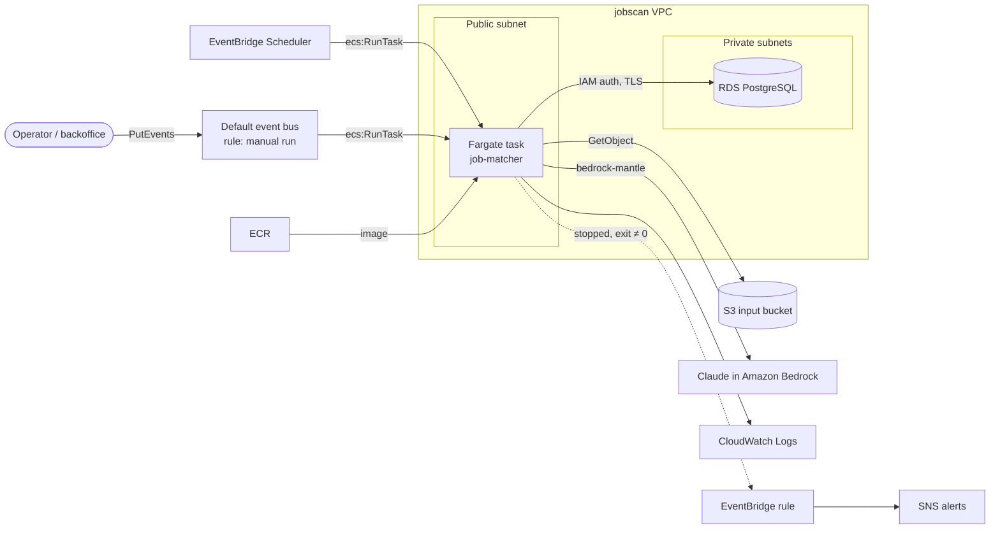

# job-matcher infrastructure

job-matcher runs as an **ECS Fargate task** in the jobscan VPC and ECS cluster. Either EventBridge Scheduler (on a timetable) or an EventBridge rule (when a manual-run event arrives) starts the task, which reads a file from S3 and data from RDS, sends it to Claude through Amazon Bedrock, and exits.



## What this stack creates

| Component | Details |
|---|---|
| **ECR** | `job-matcher-dev`. Scan on push; keeps the last 5 images. |
| **Task definition** | Fargate, 0.5 vCPU / 1 GB, `awsvpc`. Its configuration is passed as environment variables: `DB_HOST`, `DB_PORT`, `DB_NAME`, `DB_USER`, `INPUT_BUCKET`, `INPUT_KEY_PREFIX`, `CLAUDE_MODEL`, `AWS_REGION`. |
| **Networking** | Runs in jobscan's public subnet with a public IP, so it needs no NAT gateway. No inbound rules. It uses `jobscan-app-sg`, the group RDS accepts on 5432. |
| **Task role** | `s3:GetObject` and `s3:ListBucket` on the input prefix. `rds-db:connect` as `job_matcher`. `bedrock-mantle:CreateInference` limited to one model. |
| **Schedule** | EventBridge Scheduler, by default weekly, Mondays at 11:00 Europe/Madrid. |
| **Manual run** | An EventBridge rule on the default bus matches `source = "job-matcher"` and `detail-type = "Run requested"`, and starts the task. |
| **Run role** | One role, trusted by both Scheduler and EventBridge, that can only `ecs:RunTask` this task family in this cluster and pass its two roles. Both triggers use the latest task definition revision. |
| **Alerts** | An EventBridge rule on stopped tasks that exit non-zero or fail to start, which publishes to an SNS topic (optional email subscription). |
| **Logs** | `/ecs/job-matcher-dev`, kept for 7 days. |

From the jobscan API stack, it reads the VPC, security group and cluster from local state (`api_state_path`). It finds the public subnet and the RDS instance by name. **Apply the jobscan API stack first.**

## First-time setup

1. **Enable the model.** In the Bedrock console (eu-west-1), make sure the account has access to `anthropic.claude-haiku-5-5`.
2. **Create the database user** while connected as the master user (for example through the SSM port-forward described in jobscan's README):

   ```sql
   CREATE USER job_matcher;
   GRANT rds_iam TO job_matcher;
   GRANT CONNECT ON DATABASE jobscan TO job_matcher;
   GRANT USAGE ON SCHEMA public TO job_matcher;
   GRANT SELECT ON ALL TABLES IN SCHEMA public TO job_matcher;
   -- Add write grants only on the tables the job is meant to write to.
   ```

3. **Fill in `dev.tfvars`.** Set `input_bucket_name`, and `alert_email` if you want failure emails. Confirm the subscription email AWS sends you.
4. **Create the registry, push an image, then apply everything:**

   ```bash
   terraform init
   terraform apply -var-file=dev.tfvars -target=aws_ecr_repository.app
   # build and push the image to the ecr_repository_url output
   terraform apply -var-file=dev.tfvars
   ```

## Operations

- **Deploy:** push a new image with the tag in `container_image_tag` (default `latest`). The next run picks it up; no apply is needed.
- **Run now:** send the manual-run event (the `put_event_command` output):

  ```bash
  aws events put-events --entries '[{"Source":"job-matcher","DetailType":"Run requested","Detail":"{}"}]'
  ```

  Anyone with `events:PutEvents` on the default bus can trigger it. `run_task_command` starts the task directly through ECS instead.
- **Pause:** set `schedule_enabled = false` and apply.
- **State:** local, like the other stacks. Back up `terraform.tfstate`; it is git-ignored.

## Notes

- The image must run to completion and exit: a non-zero exit code marks the run as failed. In NestJS, boot it with `NestFactory.createApplicationContext()` instead of `listen()`.
- If the bucket uses SSE-KMS with a customer-managed key, the task role also needs `kms:Decrypt` on that key.
- Build the image for `linux/amd64`, or set `cpu_architecture = "ARM64"` and build for `linux/arm64`.
